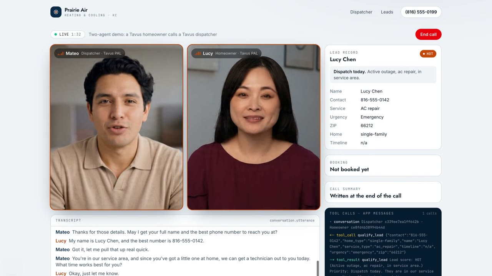
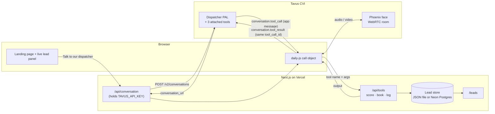

# Spearflow Lead Qualifier

**An AI SDR you can look in the eye.** A visitor lands on a home-services site, clicks *Talk to our dispatcher*, and has a face-to-face video conversation with a [Tavus](https://tavus.io) AI human. While they talk, the AI qualifies them, books the visit, and logs a structured lead record. A side panel fills in as each tool fires.

**Live:** https://tavus-lead-qualifier.vercel.app (two-agent demo at [`/?demo=1`](https://tavus-lead-qualifier.vercel.app/?demo=1), captured leads at [`/leads`](https://tavus-lead-qualifier.vercel.app/leads))

The demo business is **Prairie Air Heating & Cooling**, a fictional Kansas City HVAC company styled after my HVAC concept-site work.

[](public/demo.mp4)

▶ **[Watch the 3-minute demo](public/demo.mp4).** Two Tavus PALs hold a real, unscripted call: a homeowner whose AC died and the dispatcher. `qualify_lead`, `book_consultation`, and `log_call_summary` all fire live, and the panel on the right fills in as they do. Recorded straight from the app with Playwright.

## What happens on a call

1. **Mateo** (a stock Tavus face, Phoenix-4.5) greets the visitor and asks what's wrong: no heat, AC repair, new install, or maintenance.
2. He gathers urgency, home type, ZIP, and the best way to reach them, one short question at a time.
3. The PAL calls **`qualify_lead`**. The browser forwards it to `/api/tools`, which scores the lead (hot / warm / cold, with a reason) and checks the KC service area. The result goes back as `conversation.tool_result`, and Mateo answers based on it (`on_resolve: generate_response`).
4. He handles a quick objection (the $89 diagnostic fee) and calls **`book_consultation`**, which returns a confirmed mock slot. There's a stub where Google Calendar plugs in.
5. At the end he calls **`log_call_summary`** (`fire_and_forget`), and the lead appears on **`/leads`**.

There's also a **two-agent mode** (`/?demo=1`): a second Tavus PAL plays a homeowner whose AC died. Each PAL's voice is routed into the other one's microphone with Web Audio, so two AI humans hold the whole call by themselves. The demo video was recorded that way.

## Architecture



- The **API key stays on the server.** The browser only gets a `conversation_url` from `/api/conversation`.
- **Tools live in the Tavus tools registry** (`/v2/tools`) and are attached to the PAL (`/v2/pals/{id}/tools`), using `delivery: { app_message: true }`. The browser receives them on the Daily data channel.
- **The custom UI is built on `@daily-co/daily-js`.** It renders the PAL's video and audio tracks itself and listens for `conversation.tool_call`, `conversation.utterance`, and `conversation.replica.*_speaking` events.
- **Lead storage:** `data/leads.json` locally, memory on read-only hosts, or **Neon Postgres** when `DATABASE_URL` is set (a single `leads` table with JSONB, created automatically).

| Tool | Args | `on_resolve` | What the app does |
| --- | --- | --- | --- |
| `qualify_lead` | service_type, urgency, zip, home_type, timeline, name, contact | `generate_response` | Rule-based score + service-area check ([`src/lib/scoring.ts`](src/lib/scoring.ts)) |
| `book_consultation` | name, contact, preferred_time | `generate_response` | Parses "tomorrow morning" into a confirmed window ([`src/lib/calendar.ts`](src/lib/calendar.ts), Google Calendar stub) |
| `log_call_summary` | summary, next_step | `fire_and_forget` | Saves the CRM note to the lead |

## Setup in 5 steps

1. **Clone and install**
   ```bash
   git clone https://github.com/VikaasVenkatesh/tavus-lead-qualifier && cd tavus-lead-qualifier && npm install
   ```
2. **Add your Tavus key.** Get one from the [Tavus platform](https://platform.tavus.io).
   ```bash
   cp .env.example .env.local   # then set TAVUS_API_KEY=...
   ```
3. **Create the PAL and tools.** This creates the three tools, the dispatcher PAL (stock face *Mateo*) with the tools attached, and the homeowner PAL for the demo. It then writes their IDs into `.env.local`. Safe to re-run.
   ```bash
   npm run setup
   ```
4. **Run it**
   ```bash
   npm run dev   # http://localhost:3000, two-agent demo at /?demo=1
   ```
5. **Deploy (optional).** Push to Vercel and set `TAVUS_API_KEY`, `TAVUS_PAL_ID`, `TAVUS_FACE_ID` (plus the two `TAVUS_HOMEOWNER_*` values for the demo, and `DATABASE_URL` if you want leads to persist).
   ```bash
   vercel --prod
   ```

## Project map

```
scripts/setup-tavus.ts        creates tools + PALs through the Tavus API, writes .env.local
src/lib/tavus-config.ts       PAL prompts, tool schemas, stock face IDs (single source of truth)
src/lib/cvi-client.ts         Daily call wrapper (tool_result replies) + AudioBridge for the two-agent demo
src/app/api/conversation      creates / ends Tavus conversations server-side
src/app/api/tools             runs qualify / book / log and persists the lead
src/lib/store.ts              JSON-file or Neon Postgres lead store
src/components/Experience.tsx call stage, transcript, and event handling
src/components/LeadPanel.tsx  live lead card, booking, summary, and tool-call stream
src/app/leads                 captured leads table
```

## Why I built this

I built this for my **Tavus Vibe Growth Marketer** application. I wanted to show the thing I'd be marketing, an AI human that qualifies leads face to face, working end to end on a real growth use case and not just a canned video. It extends work I've already shipped: **Spearflow**, my AI voice receptionist for home-services businesses, and my concept redesigns for local HVAC sites. Moving from voice to a face that can see you, book you, and write the CRM note is the obvious next step. Tavus makes that one API call plus three tools.

---

*Prairie Air Heating & Cooling is fictional. Mateo and Lucy are Tavus stock faces.*
